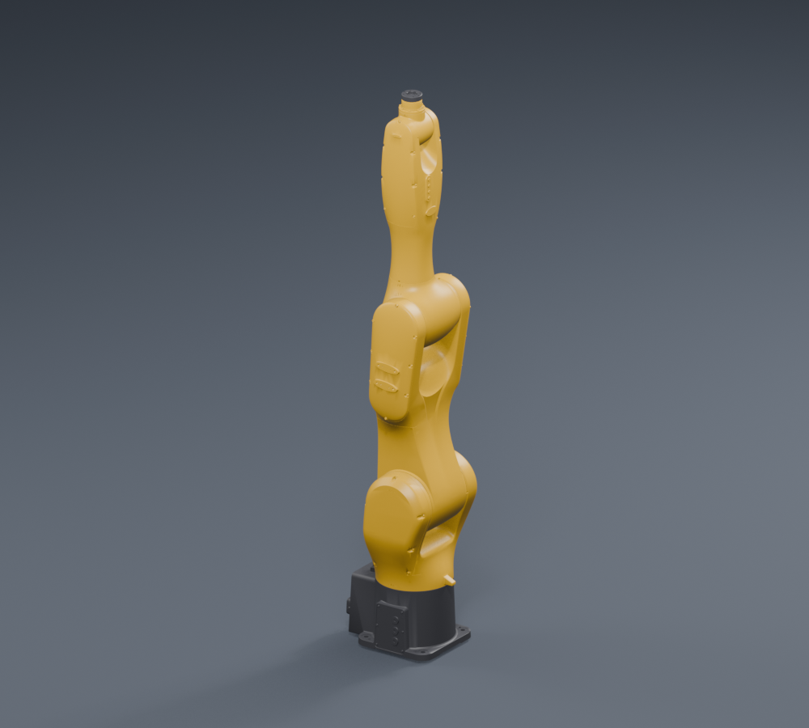
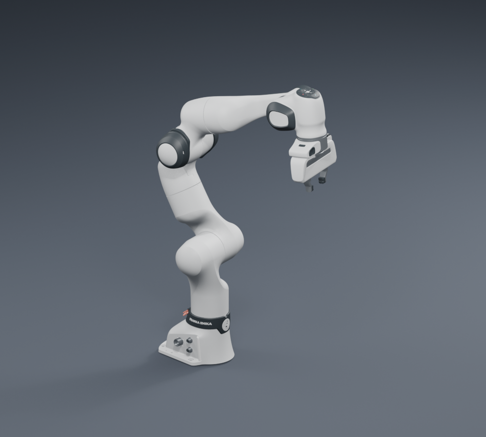
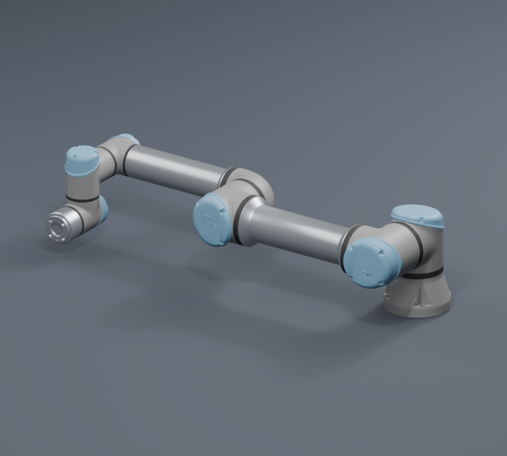
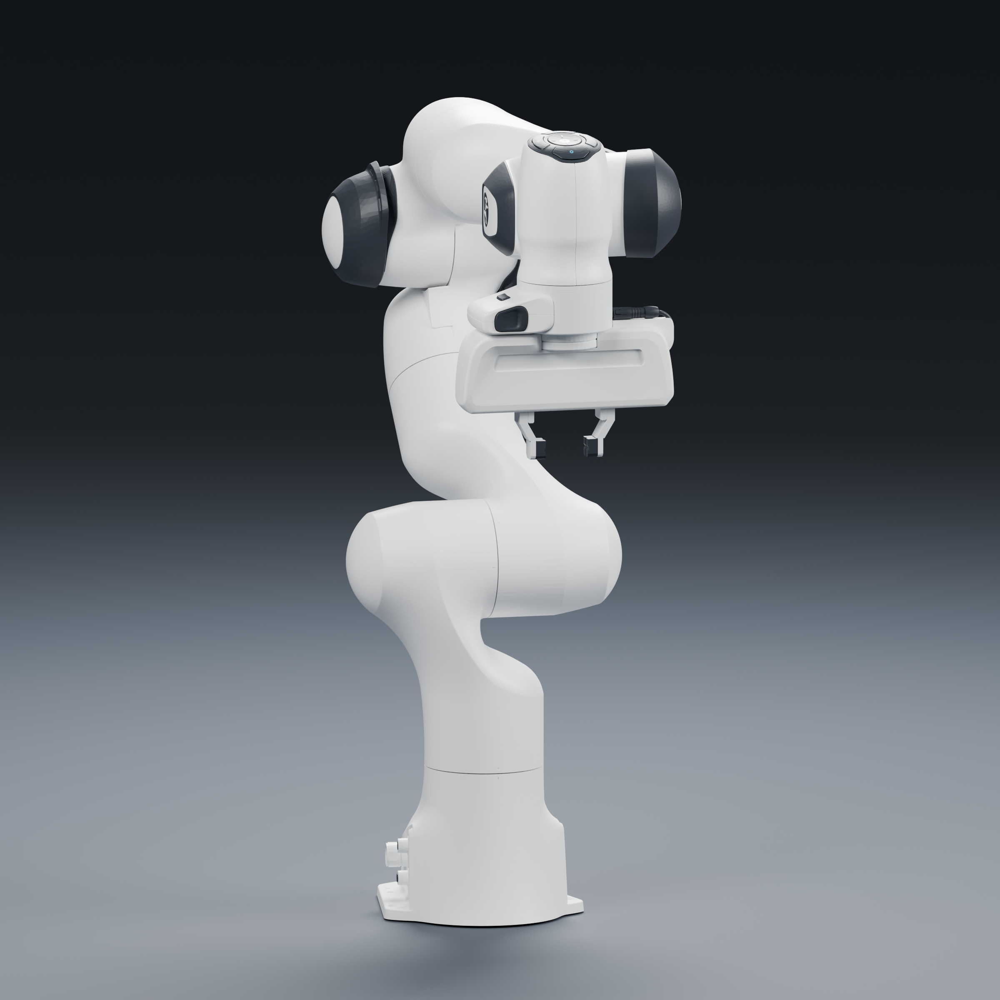
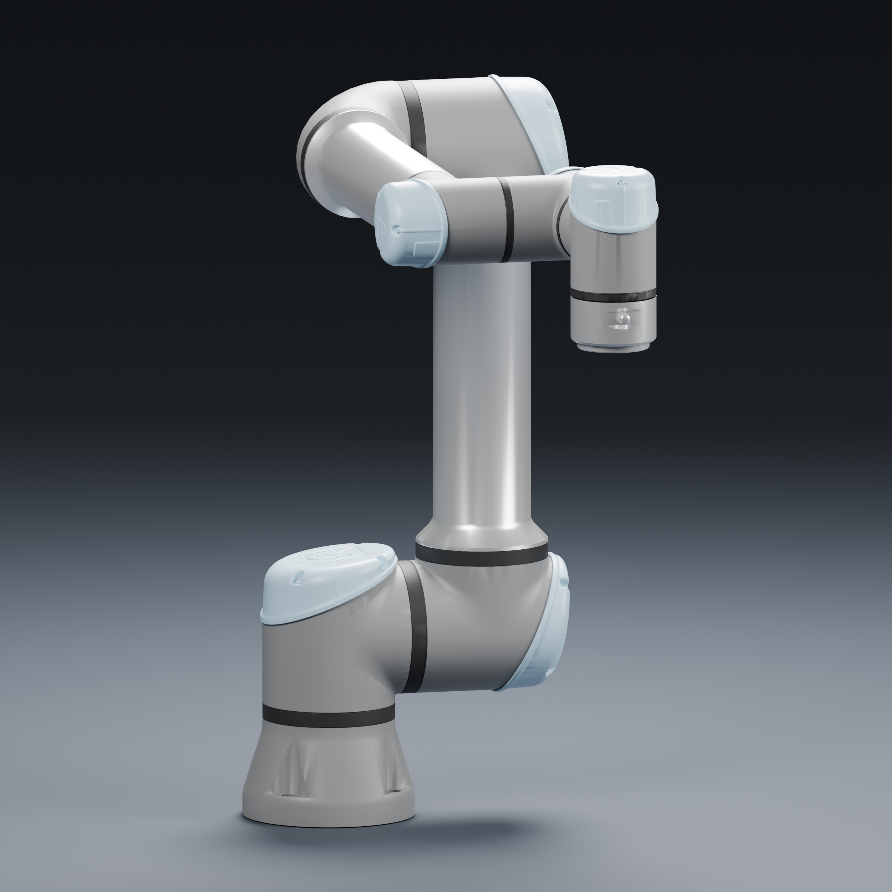
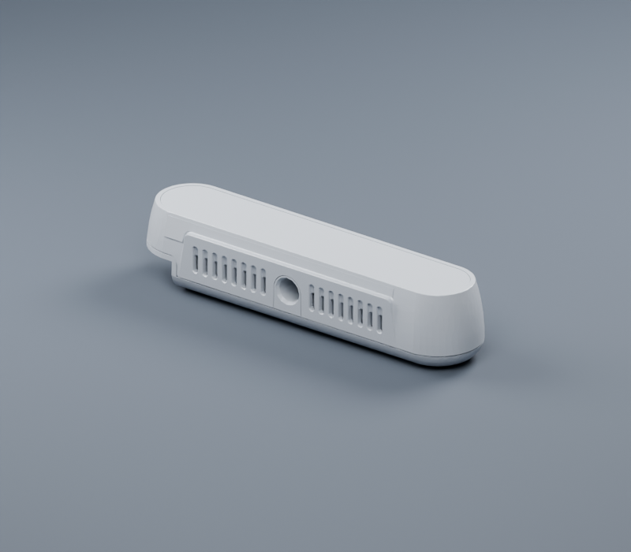
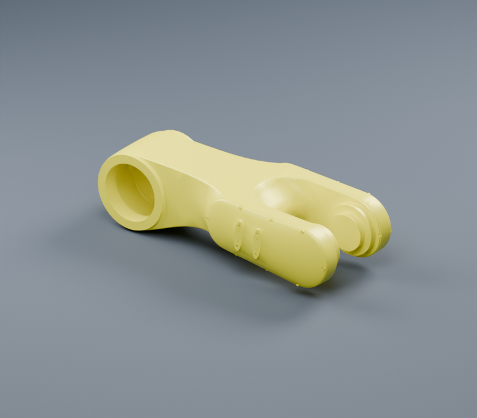

# AssetsModel

Portable URDF assets for robot planning, simulation, and visualization.

**75 URDF variants · 12 robot vendors · 874 GLB meshes · 420 optional STL meshes**

[Model catalog](docs/CATALOG.md) · [New robots](docs/NEW_ROBOTS.md) · [Brand materials](docs/BRAND_MATERIALS.md) · [Surface normals](docs/NORMAL_REFINEMENT.md) · [Asset layout](docs/ASSET_LAYOUT.md) · [Before / after viewer](docs/preview.html) · [GLB conversion report](docs/GLB_REPORT.md) · [工具使用说明](docs/MESH_WORKFLOW.md)

All URDFs now reference **GLB meshes in their model directories**. Visual and collision resources use format subdirectories such as `Visual/glb/`, `Visual/stl/`, `Collision/glb/` and `Collision/stl/`; cameras and tools use `meshes/glb/` and `meshes/stl/`. **The runtime tree contains no DAE files or duplicate top-level GLB tree.** Imported source archives retain original DAE inputs for traceability. GLBs occupy **227.7 MiB**; retained STL alternatives occupy **245.0 MiB**. Copy a model directory, or export only its GLB runtime resources using the [workflow](docs/MESH_WORKFLOW.md).

| Peitian AIR10-1210 | Franka FR3 | Universal Robots UR5e |
| :---: | :---: | :---: |
|  |  |  |

Previews use the embedded PBR materials and the joint poses recorded in the [preview manifest](docs/quality/preview-models.json). Meshes retain their original model coordinates and units.

## Find a model

| Category | URDF variants | Directory convention |
| --- | ---: | --- |
| Industrial robots and arm/hand variants | 64 | `RobotModel/<Vendor>/<Model>/` |
| RealSense cameras and plug variants | 10 | `CameraModel/RealSense/<Model>/` |
| Robotiq 2F85 gripper | 1 | `ToolModel/Robotiq2F85/` |

The [complete catalog](docs/CATALOG.md) links every URDF and lists its link and actuated-joint counts. Mimic joints are excluded from the actuated-joint count.

## Models moved from HumanoidAssets

The original Panda and official-description UR5e now live here alongside the
existing FR3 and UR5e models. Existing model files remain unchanged.

| Model | Entry points | Notes |
| --- | --- | --- |
| Franka Panda | [robot](RobotModel/Franka/Panda/robot.urdf), [arm](RobotModel/Franka/Panda/arm.urdf), [hand](RobotModel/Franka/Panda/hand.urdf) | Original Panda, distinct from FR3; [source and limits](RobotModel/Franka/Panda/SOURCE.md) |
| UR5e official variant | [robot](RobotModel/UniversalRobots/UR5e_Official/robot.urdf) | Official ROS2 frame tree and physical values; distinct from `UR5e/UR5e.urdf`; [source](RobotModel/UniversalRobots/UR5e_Official/SOURCE.md) |

| Franka Panda | UR5e official variant |
| :---: | :---: |
|  |  |

Their visual GLBs and previews retain the HumanoidAssets source bytes. Collision
GLBs preserve all original STL triangles, with optional STL copies retained.
Source DAE/Xacro/configuration and original import records are archived in each
model's `source.tar.gz`; the active tree follows the GLB layout. Licenses,
provenance hashes and migration validation accompany both models. Joint names,
frames, limits, dynamics and mimic relations are preserved. Use each `home.json`
for the legal display pose; Panda's coordinate-zero pose is outside its J4 limit.

## Use an asset

Pass the URDF path to your robotics application. Keep the URDF and its mesh directories together when copying a model.

```text
RobotModel/UniversalRobots/UR5e/UR5e.urdf
CameraModel/RealSense/RealSense_D405/RealSense_D405_and_plug.urdf
ToolModel/Robotiq2F85/Robotiq2F85.urdf
```

All resource references are relative to the URDF directory and point to `glb/` subdirectories. Existing `Visual` and `Collision` capitalization is retained; format directory names are lowercase. STL alternatives are optional and are not referenced by the default URDFs. Compose robot/tool/camera assemblies in the consuming project.

## Mesh quality

The November 2026 update refines brand colors and distinguishes painted surfaces, polymers, rubber and metal. It smooths flat CAD shading on curved surfaces while retaining mechanical creases, and batches compatible static surfaces without changing their geometry. It also adds **xArm6, Lite6, KUKA iiwa14 and Kinova Gen3** using fixed upstream sources, with licenses and provenance retained. View the [material comparisons](docs/preview.html), [brand notes](docs/BRAND_MATERIALS.md) and [new-model verification](docs/quality/new-robots-independent-audit.json).

Existing GLBs are **33.0% smaller** than the November task baseline. An [independent check of all 781 existing GLBs](docs/quality/existing-surface-preservation.json) confirms unchanged oriented geometry in every scene; old URDFs, collision assets and optional STL files remain byte-identical. Compatible [static draw batches](docs/MESH_BATCHING.md) fall from 265 to 53 across the 20 processed files.

The September 2026 optimization reduced mesh data from **1,256.9 MiB to 618.5 MiB (50.8%)**, and triangle count from **20,608,370 to 10,407,054 (49.5%)**.

- Simplified 161 dense meshes with measured geometry checks.
- Cleaned 5,015 additional zero-area triangles across 71 meshes.
- Preserved material groups and added smooth normals with 30° hard edges to processed DAE surfaces.
- Retained original geometry when simplification failed the acceptance checks.

| D415: 425,160 → 20,000 triangles | AE Link2: 330,132 → 33,012 triangles |
| :---: | :---: |
|  |  |

Use the [interactive comparison](docs/preview.html) for original/optimized views, or the [report](docs/OPTIMIZATION_REPORT.md) for per-file counts and measured limits. Statistics cover mesh files, excluding Git history and documentation.

## Validate and maintain

Basic checks require Python 3.10+ and no third-party packages:

```bash
python3 scripts/validate_assets.py --meshes --layout --json /tmp/assets-validation.json
python3 -m unittest discover -s tests -v
```

Geometry audit, simplification, and rendering use the optional [mesh dependencies](requirements-mesh.txt); simplification/rendering also require Blender. See the [workflow](docs/MESH_WORKFLOW.md) for commands, backup behavior, and acceptance thresholds.

The supplied models are not all ready for dynamic simulation: the validator reports missing inertial data and zero effort/velocity limits separately. Review these parameters for your application. Geometric sampling is not a certified collision clearance bound.

## Contribute

1. Follow the category/vendor/model layout and keep each model directory self-contained.
2. Use relative GLB resource paths and format subdirectories; retain optional STL files under `stl/`. Convert incoming DAE files before adding assets.
3. Preserve link frames, units, material assignments, and meaningful mechanical details.
4. Run validation and the geometry audit; add the model to the generated catalog.
5. Document physical parameter sources and include a preview when available.

The [November 3 quality review](docs/QUALITY_REVIEW.md) records the earlier geometry and collision audit. Its asset counts, hashes and screenshots describe that historical revision; subsequent brand materials, normals and imported models are retained.
