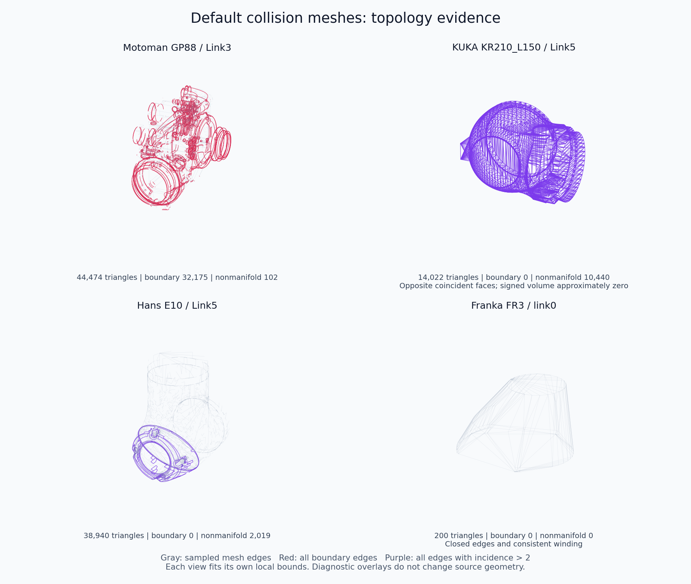

# 默认碰撞网格质量检查

本次按 **67 个 URDF 的实际 collision 引用**检查了 **377 个唯一 GLB、409 次网格引用**，共 4,825,794 个三角形；另有 10 次 box 碰撞几何，不计入网格拓扑统计。全部网格可加载。逐文件 SHA-256、使用它的 URDF/link、面数、边界、连通分量和体积见 [collision-topology.json](collision-topology.json)。

| 指标 | 唯一网格数 |
| --- | ---: |
| 每条边恰由两个面使用（watertight） | 183 |
| 存在边界边 | 176 |
| 存在由三个及以上面共用的非流形边 | 101 |
| 绕序不一致 | 31 |
| 存在重复几何三角形（忽略方向） | 25 |
| 总有符号体积接近零 | 5 |

上述问题指标有重叠，共涉及 195 个网格、47 个 URDF。**开放或非流形网格不等于所有三角形碰撞算法都不可用**，具体取决于引擎和碰撞形状配置；但这些表面不宜直接作为闭合实体积或惯量的来源。本检查没有执行特定引擎的碰撞测试，也没有检测自交。

## 代表案例

| 资源 | 观察 |
| --- | --- |
| KUKA KR210_L150 Collision Link1、Link3、Link4、Link5、Link6 | 存在重合反向面，总有符号体积约为零。以 [Link5](../RobotModel/KUKA/KR210_L150/Collision/glb/Link5.glb) 为例，14,022 面中有 7,011 个重复几何面，10,440 条非流形边。表面存在不代表可直接解释为有效闭合体积。 |
| Motoman GP88 [Collision Link3](../RobotModel/Motoman/GP88/Collision/glb/Link3.glb) | 44,474 面，32,175 条边界边、102 条非流形边。Link1 另有 24,685 条边界边；其余链接也有不同程度的开放边界。 |
| Hans E10 [Collision Link5](../RobotModel/Hans/E10/Collision/glb/Link5.glb) | 没有边界边，但仍有 2,019 条非流形边；“看起来闭合”和边界数为零都不足以判断闭合实体质量。 |
| Franka FR3 的 10 个 Collision GLB | 全部边闭合、绕序一致，没有非流形边或重复面；这些专用粗几何在本次表面拓扑指标下正常。[link0](../RobotModel/Franka/FR3/Collision/glb/link0.glb) 仅 200 面。 |
| Robotiq 2F85 的 5 个 coarse 碰撞 GLB | 全部边闭合、绕序一致，没有非流形边或重复面。 |

图中灰色为抽样网格边，红色为全部边界边，紫色为全部非流形边；各视图分别适配自身包围盒，图示没有修改资产。

## 方法与使用限制

加载 GLB 默认场景并应用节点变换，再精确焊接相同 POSITION；不做坐标量化、不合并相近但不相等的位置。连通分量按焊接后的顶点连接关系统计。所有实际碰撞网格引用的 URDF scale 均为 `1 1 1`。

总有符号体积接近零的阈值为包围盒对角线立方的 `1e-12`（最小 `1e-30`）。另对闭合连通分量以各自包围盒中心为原点计算有符号体积：93 个网格包含共 883 个负体积分量。负分量可能是内腔边界，也可能是反向外壳，未做包含关系或物理语义验证，因此仅作为复核信息，不自动翻面。FR3 finger 也保留两个负分量；闭合、绕序一致仍不等于已验证可直接生成动力学参数。

本轮保留碰撞表面的实际形状，不自动封洞、补造内腔或重建实体。需要可靠体积、惯量、凸分解或保守碰撞代理时，应结合原始 CAD 和目标引擎逐模型验证，尤其是 KUKA 的重合反面与 Motoman 的大量开放边界。
