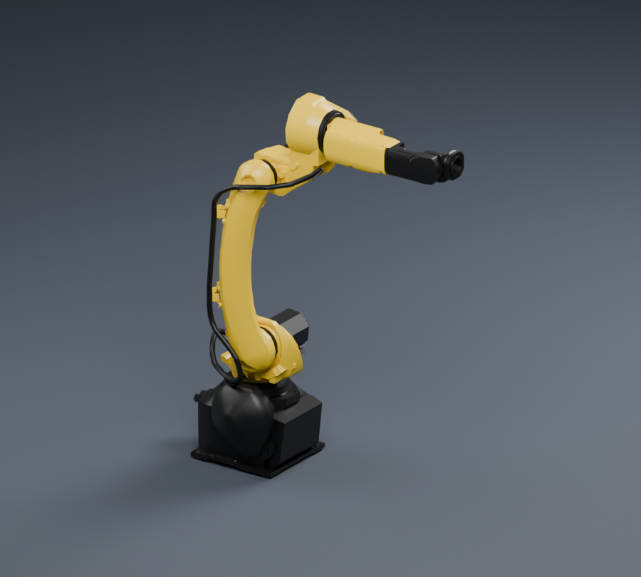
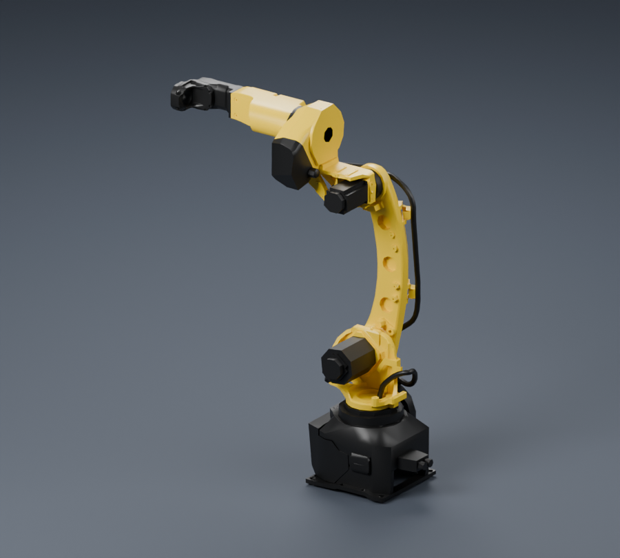
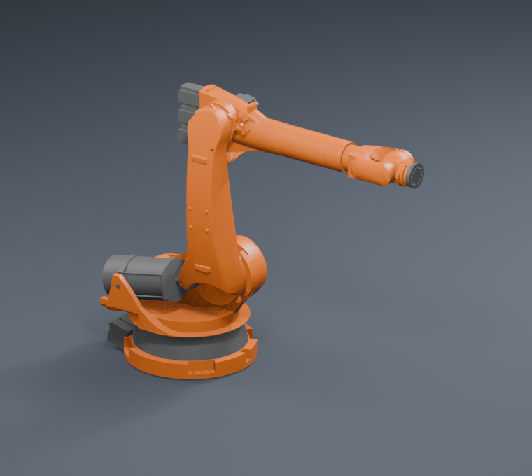
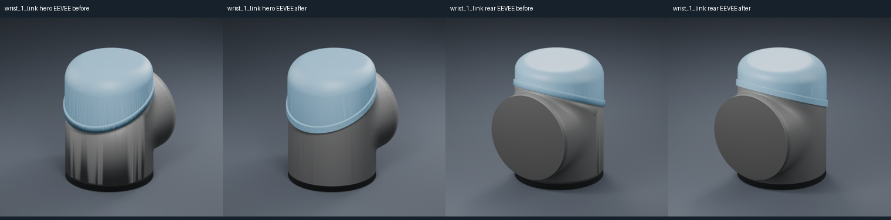
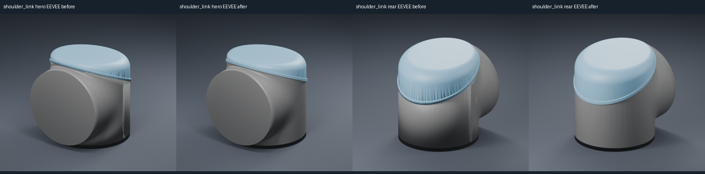
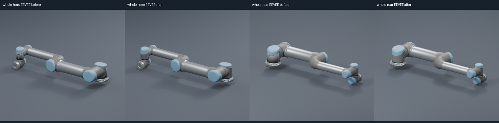

# 曲面法线与机械硬边

本轮优先处理 CAD 外观采用逐面法线、曲面显示出明显棱面的情况。法线调整保留三角形坐标、顺序与绕序，保留材质、节点和场景；不移动表面、增加面数或修改碰撞资源。

## 已采用：FANUC M-10iD/12

该模型默认引用的七个外观 GLB 共 12,395 面，全部是逐面法线。保留的 STL 备选也没有更高的曲面几何密度，因此本轮基于现有真实外观改善曲面着色。

按 30° 阈值在局部顶点扇区平滑，超过阈值的机械硬边保持。已有平滑法线的 primitive 整组保留；不依靠把所有角点无条件平均来掩盖折角。该步骤改动 34,638 个角点法线，文件总量从 964,264 降到 473,528 字节。面数与几何轮廓不变，源低多边形轮廓仍保持原样。

[写入记录](quality/fanuc-normal-refinement.json)包含逐文件输入/输出 SHA、被处理分区和方向保护策略。已完成正反两个视角目视检查、七项回归检查和 Khronos 格式校验。守卫修订后重新生成的七个文件与评审版本逐字节一致。

| 正面斜视 | 背面斜视 |
| --- | --- |
|  |  |

## 复现与保护范围

```bash
python3 scripts/refine_visual_normals.py \
  --files RobotModel/Fanuc/M_10iD_12/Visual/glb/BaseLink.glb \
          RobotModel/Fanuc/M_10iD_12/Visual/glb/Link1.glb \
          RobotModel/Fanuc/M_10iD_12/Visual/glb/Link2.glb \
          RobotModel/Fanuc/M_10iD_12/Visual/glb/Link3.glb \
          RobotModel/Fanuc/M_10iD_12/Visual/glb/Link4.glb \
          RobotModel/Fanuc/M_10iD_12/Visual/glb/Link5.glb \
          RobotModel/Fanuc/M_10iD_12/Visual/glb/Link6.glb \
  --output /tmp/fanuc-normal-review \
  --report /tmp/fanuc-normal-review.json
```

输出必须在资源树之外，工具不覆盖默认资产。当前资源已经采用这一轮法线更新，直接重跑会保留已有平滑分区；要复现上述前后降幅，需要用 `--root` 指向记录中输入 SHA 对应的采用前文件。

通用平滑工具只处理完全采用逐面法线的分区，并检查 authored normal 与几何面方向是否一致。纹理、蒙皮、动画和不能保留的访问器元数据明确拒绝。全库平面着色调查见[候选记录](quality/flat-shading-candidates.json)：它是进一步评审的输入，不能视为所有候选都需要或已经修改。下文 UR5 的已有平滑法线修复采用独立的固定角点清单，不放宽这一通用守卫。

CAD 正反共面层属于独立的有向表面，普通非流形邻接不能把两面平均。有向表面扇区与局部异常法线保护的已采用结果见下文及对应写入记录。

## 已采用：KUKA KR210 L150 的正反 CAD 表面

该模型的正反共面表面保留，两面分别沿有向边建立局部扇区。只有反向行进、法线夹角不超过 30°、且彼此为唯一兼容邻面的组合参与平滑；歧义边保持原有分离，正反层不会互相平均。

七份外观 GLB 的 88,216 面均保留，235,997 个角点法线得到更新。725 个方向异常的源面不参与平滑，其法线原字节保留；没有新增与绕序相反的法线角点。文件合计从 6,794,032 降为 2,340,588 字节，尺寸、材质、节点和场景保持相同。完整记录见[有向表面写入记录](quality/oriented-normal-refinement.json)。

| 原逐面法线 | 有向表面曲面法线 |
| --- | --- |
|  |  |

这一类共面 CAD 使用 EEVEE 原生单面剔除验收，正反两个视角均已目视检查。普通 Cycles 背面行为及其限制见[预览质量说明](VISUAL_QUALITY.md)。

## 全库采用与逐型号复核

完成前三款 pilot 的局部异常保护验证后，本轮又处理了 45 个型号、228 个默认外观 GLB 中的 301 个明确曲面分区。所有输入同时满足：属于任务开始时的网格路径、实际被 URDF 外观引用、原分区完全采用逐面法线且有足够的曲面邻接依据。未选择的分区、已有平滑法线及异常面均保留，新增导入型号使用其独立导入策略。

[全库写入记录](quality/global-normal-applied.json)逐文件保存输入/输出 SHA 与分区选择；[独立数据审计](quality/global-normal-independent-validation.json)重新从 XML、默认场景和二进制角点核对全部范围。[逐型号视觉复核](quality/global-normal-visual-review.json)覆盖 45 款、180 张相同姿态与光照的正反前后图，未发现这些视图中新增的明显翻面、黑洞或波浪面。

| 阶段 | 实际修改 GLB | 曲面处理中的源三角面 | 改善的法线角点 |
| --- | ---: | ---: | ---: |
| FANUC M-10iD/12 | 7 | 12,395 | 34,638 |
| KUKA KR210 L150 | 7 | 88,216 | 235,997 |
| Motoman MH12、UR3e、ABB IRB2600 pilot | 18 | 238,062 | 671,013 |
| 其余 45 个型号 | 228 | 1,914,049 | 5,188,085 |
| 逐面法线阶段小计（50 款） | **260** | **2,252,722** | **6,129,733** |

表中的三角面没有被减少或移动。通过共享全部属性相同的顶点、重打包索引和法线，数据体积下降；曲面法线改进保持碰撞文件、URDF 运动学及原有机械几何。

完整联系表（每行依次为正面原始/更新、背面原始/更新）：

- [型号 01–08](previews/curves-models-01-08.jpg)
- [型号 09–16](previews/curves-models-09-16.jpg)
- [型号 17–24](previews/curves-models-17-24.jpg)
- [型号 25–32](previews/curves-models-25-32.jpg)
- [型号 33–40](previews/curves-models-33-40.jpg)
- [型号 41–45](previews/curves-models-41-45.jpg)

当前文件已采用处理结果。重新生成剩余曲面候选与独立试验的工具分别为 `scripts/audit_flat_shading.py`、`scripts/build_visual_normal_trials.py`；有向曲面策略也可通过 `refine_visual_normals.py --oriented-sheets --preserve-direction-outliers` 选择。独立二进制检查可使用 `scripts/verify_normal_updates.py`，不依赖生产代码的访问器解码。

## 已采用：UR5 既有平滑法线的局部例外

旧款 UR5 / CB3 的 `wrist1.glb` 和 `shoulder.glb` 原本已有平滑法线，因此前述通用工具保留了它们。后续隔离检查发现，部分圆柱侧面几何几乎共面，源角点法线却相差约 60°–93°；较小的 3°–8° 法线摆动也会形成蓝盖细纹。条纹在独立显示部件、粗糙度设为 1、EEVEE 与 Cycles 对照时均存在。[官方 CB3 服务手册](https://www.universal-robots.com/download/manuals-cb-series/service/service-manual-ur5-cb3-english/)的腕部实物与装配图未显示对应的密集纵槽。完整定位、参考页码和试验取舍见[条纹诊断](quality/ur5-stripe-diagnosis.json)。

本次仅对两个固定输入 SHA 中、已核实圆柱区域的 **5,805 个角点法线**应用局部有向扇区目标，另外 **76,875 个角点法线逐字节保留**。两个文件的 27,560 个三角形、位置、顺序、绕序、材质、节点和场景不变；黑色胶圈、环缝与机械外形保留。精确 P+N 属性去重后，两文件合计增加 920 字节。

[独立审核](quality/ur5-local-normal-independent-validation.json)使用单独的标准库二进制解码器，检查有向角点及材质分区之间的共享边。2,039 个同时具有几何与源法线硬边的端点没有被合并，未增加相反朝向法线或近共面法线接缝。两种渲染器的正背视角均已目视复核，另有整个 UR5 的装配对比；Khronos 检查为 0 错误、0 警告。

以下每幅依次为正面原始、正面修复、背面原始、背面修复：







加入这个独立例外后，任务开始时已有模型的专项法线改进累计为 **51 款机器人、262 个外观 GLB**，更新 **6,135,538 个角点法线**。上表保留此前 50 款、260 个 GLB 的逐面法线阶段统计；本次 UR5 不包含在该阶段中。四款新导入模型的源法线处理另见[新增机器人](NEW_ROBOTS.md)，不合入这组既有模型统计。

采用记录见[两文件写入记录](quality/ur5-local-normal-applied.json)，精确选择范围见[固定角点清单](quality/ur5-local-normal-mask.json)。`scripts/repair_ur5_local_normals.py` 只接受这两份输入 SHA，并检查输出角点法线哈希，不会自动寻找其它型号或分区；输出必须在仓库和源模型目录之外。当前资产已采用修复结果，不能直接作为该清单的原始输入。可使用诊断时的完整快照，或在模型副本中恢复采用记录所列的两个备份文件后复现：

```bash
python3 scripts/repair_ur5_local_normals.py \
  --source-model /tmp/assetsmodel-session-ur5-stripe-diagnosis/snapshot/RobotModel/UniversalRobots/UR5 \
  --output-model /tmp/ur5-local-normal-review/RobotModel/UniversalRobots/UR5 \
  --report /tmp/ur5-local-normal-review.json
```

最新[可复现输出记录](quality/ur5-local-normal-trial.json)包含当前脚本和清单 SHA；补充 `CameraModel` 报告路径保护后，重新生成的两个 GLB 与已采用版本逐字节相同。采用记录中的原脚本 SHA 保留为采用时的历史值。
