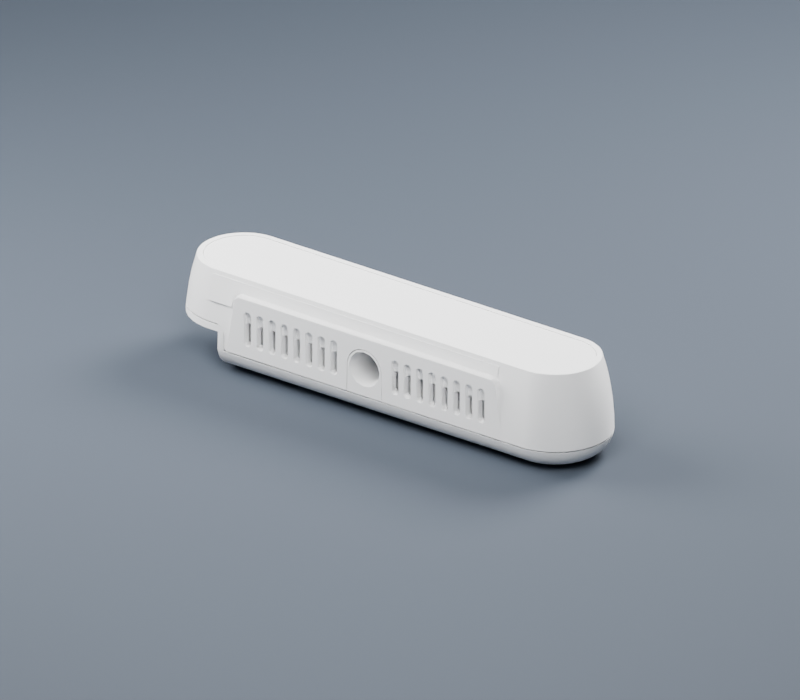
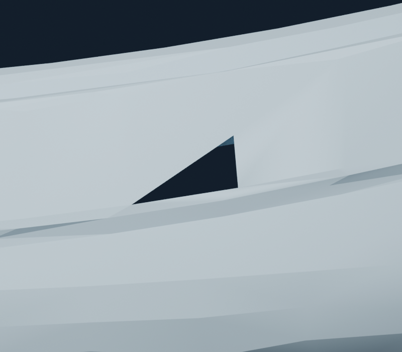
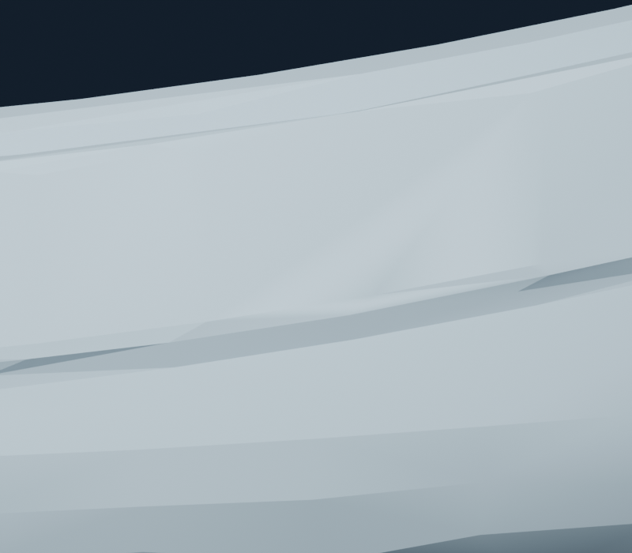
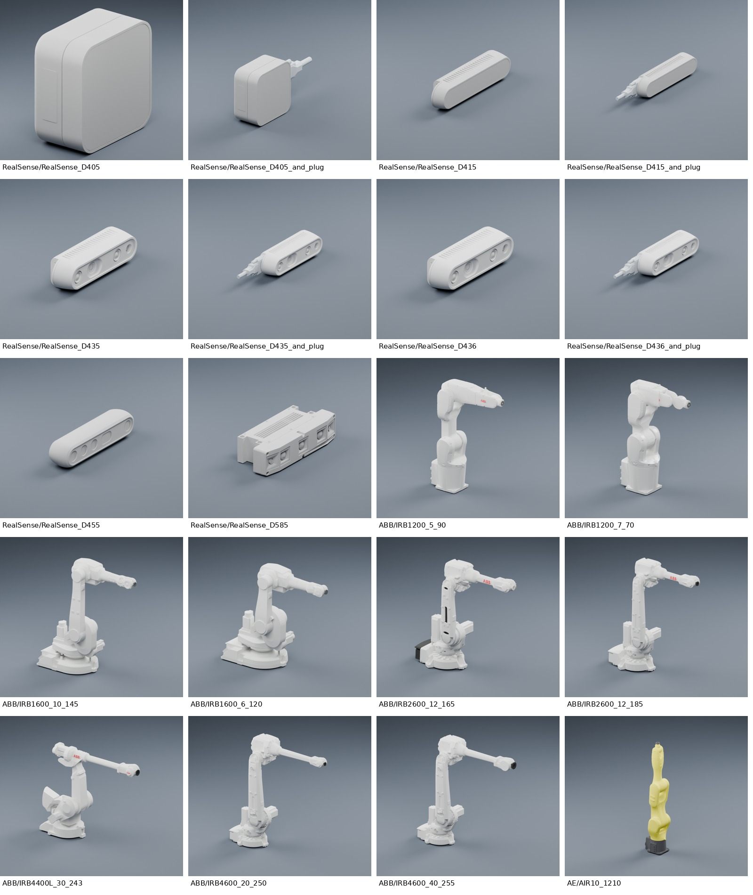
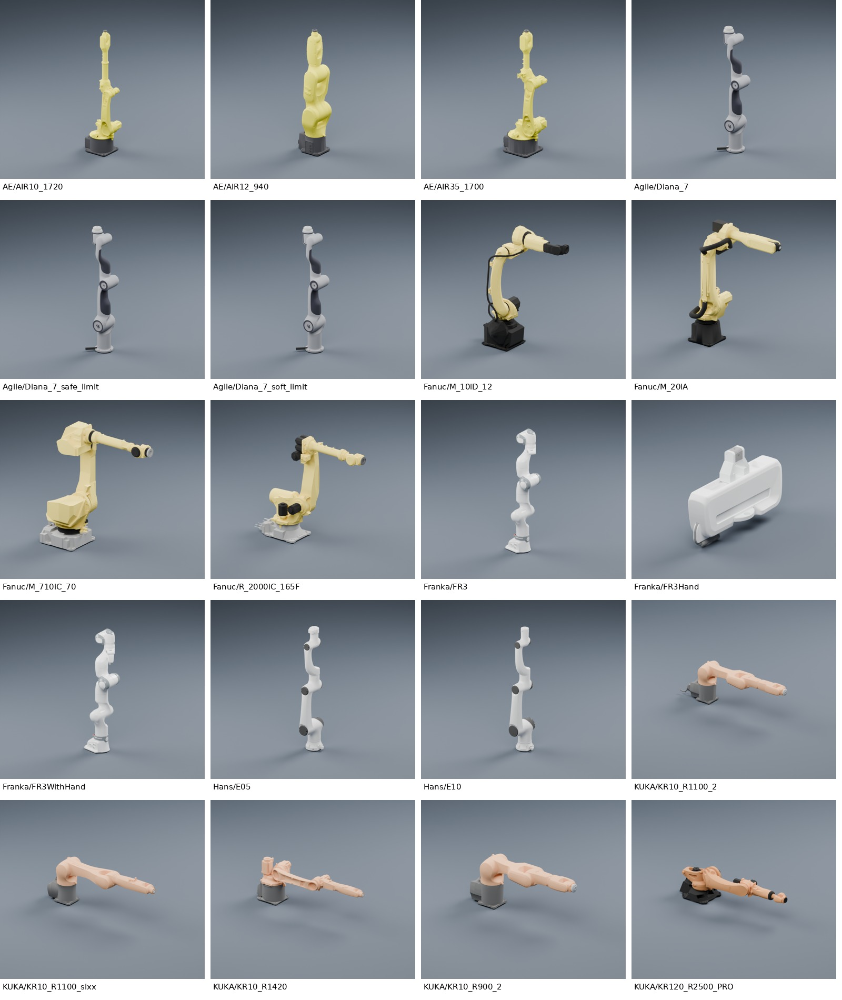
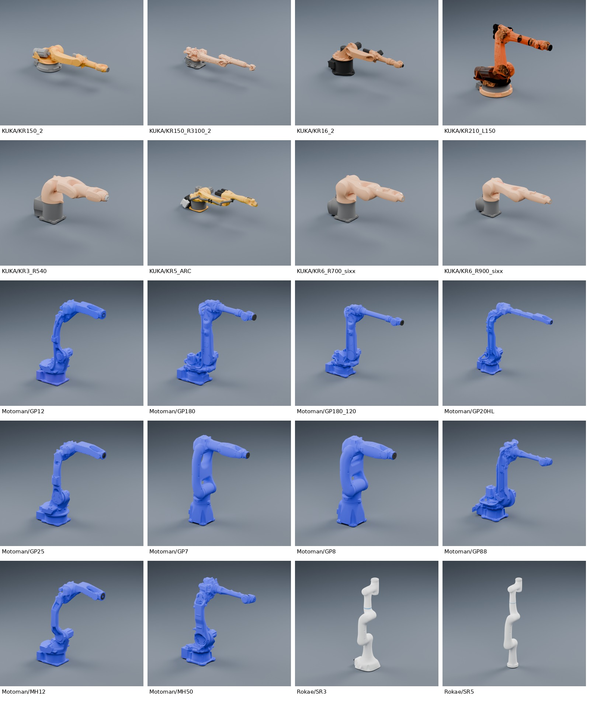
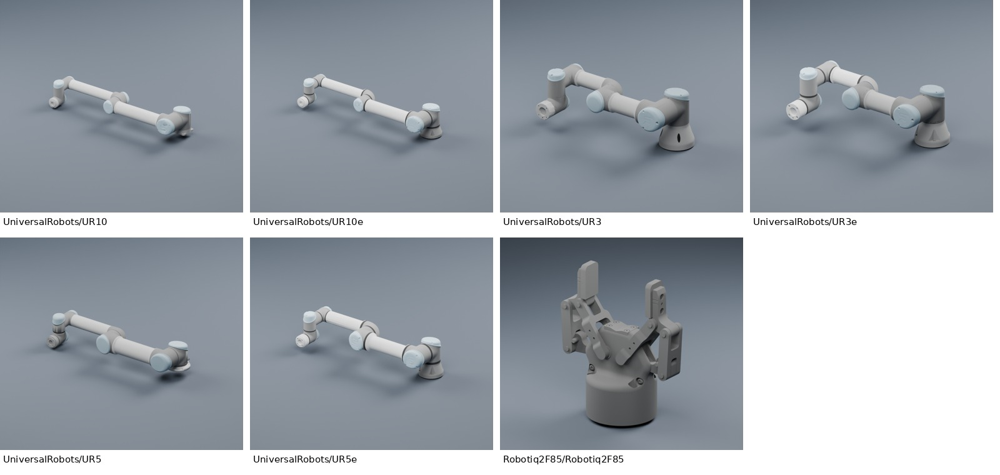

# 2026-11-03 资产质量检查

基线为 `6bd45a7`。本轮检查覆盖 67 个 URDF、781 个 GLB 和 404 个保留的 STL。用户工作区已有的 Robotiq 修改不包含在此 PR 中。

## 已采纳的改动

### 同材质网格合批

37 个 GLB 的静态子网格按材质合并，包括 33 个外观和 4 个 ABB 碰撞资源。此阶段 primitive 数从 **327 降至 100**，顶点从 **912,177 降至 895,177**，体积从 **24,686,764 降至 24,302,580 bytes**。面数不变。

每个场景、材质、属性布局中的三角形角点流均逐字节校验：位置、法线、绕序和材质归属一致，辅助 CAD 线保留。源 CAD 名称保存在合并 mesh 的 `extras.sourceParts`。有透明混合、动画、纹理、非单位节点变换或未知元数据的资源不参与此工具。

KUKA KR210_L150 整机默认场景的视觉 primitive 实例从 **171 降至 15**，原 **88,216 个三角形**保持不变。primitive 实例用于估计绘制调用，实际帧率仍取决于消费端渲染器。完整阶段记录见 [glb-batching.json](glb-batching.json)。

### 精确正反面压缩

在合批之后，对 KUKA KR210_L150 的六个外观 GLB 进一步识别同位置、同材质、角点法线精确互为负值的正反面，仅将这些配对改为 glTF 单层双面材质。其余表面原样保留，正反颜色不同的部分不处理。此阶段减少 **12,874 个三角形、899,424 bytes**；整机视觉三角形 **88,216 → 75,342（−14.6%）**，最终视觉 primitive 实例为 **16**。

默认 GLB 总面数由 **10,496,097 → 10,483,223**，体积由 **308.53 → 307.30 MiB**（包含合批及材质补齐）。本轮所有碰撞表面和全部 URDF 均保持不变。见 [双面压缩记录](glb-double-sided.json)。

Three.js r150 / Chrome SwiftShader 在六文件正反两个视角的 **12 组光栅渲染对照**中，7 组逐像素相同，其余每图仅 1–3 像素不同；最大整图 RGB 平均绝对差为 0.000075/255，99 分位为 0。另有 12 个文件、24 组合批前后渲染逐像素相同。证据分别见 [双面渲染对照](glb-paired-surface-webgl.json)、[合批渲染对照](glb-batching-webgl.json)。

这一优化保持 glTF 光栅化的正反面着色语义。Cycles 对原有重合面和透明背面模拟的射线/自遮挡表现有明显差异，因此不能宣称跨所有渲染器逐像素一致；需要原始双层拓扑的应用可使用保留的 STL 或基线版本。

### 材质可移植性与预览

RealSense D405/D415/D455/D585 和 ABB IRB1200_5_90 Link5 的 GLB 原先没有嵌入材质，仅 URDF 声明颜色。现在把所有引用都一致的 RGBA 写入 GLB，并显式设为非金属漫反射；位置、法线和整个 BIN 数据逐字节保留。颜色冲突、缺色、已有材质和与碰撞共享的文件均跳过。见 [材质记录](glb-material-embedding.json)。

预览读取浮点颜色、实际 metallic/roughness、发光、透明度、双面属性及内嵌 base color 纹理和 UV。旧工具统一使用 metallic=0.12、roughness=0.38，而且通过 8-bit 主色丢失精度，不能代表实际材质。新工具在 GLB 已有材质时保留其材质分组，无材质时才使用 URDF 颜色，并拒绝不支持的着色特性。光照和色彩管理依然会影响最终图像。

| D415 独立 GLB：原默认白色金属 | 嵌入已有 URDF 灰色、非金属 |
| --- | --- |
|  |  |

### 修复背面剔除造成的小孔

UR10 的 Link1、Link4 各有一个反向三角面。每处都满足：三个角点法线与绕序相反、三条流形邻边方向冲突、三个邻面绕序与法线一致、没有同位置重叠面。交换两个索引后恢复一致，不改位置、法线、材质或面数。完整证据见 [glb-winding-repair.json](glb-winding-repair.json)。

| 修复前：Link4 三角孔 | 修复后 |
| --- | --- |
|  |  |

## 面片预算和后续候选

运行时统计按 URDF 的实际实例累计，同一手指引用两次计两次；CAD 辅助场景不计入默认表面。文件体积则按唯一资源累计，避免重复计下载量。

| 模型 | 视觉三角形 | 碰撞三角形 |
| --- | ---: | ---: |
| AE AIR35_1700 | 317,998 | 446,329 |
| AE AIR12_940 | 309,638 | 388,687 |
| Hans E10 | 275,439 | 235,618 |

这些面数用于发现瓶颈，并非适用于所有仿真的硬性上限。继续减面时同时检查细小零件、孔洞、材质边界、法线着色和拓扑。部分候选通过采样位置误差检查，但在薄壁和重叠表面上的最近面法线转移有明显误差，尚未替换主资产。

AIR12_940 碰撞 Link1 的只读分件实验可从 160,436 降至 105,970 面，90,000 个总装探针的最大距离约 0.124 mm，12 个闭合分件保留。但采样不是保守碰撞包络证明，本轮不据此更换默认碰撞形状。KUKA 有大量正反重叠面，其中一部分正反颜色不同，不能直接去重。

实际引用的 **377 个碰撞 GLB、409 次引用**另完成拓扑审计：176 件有开放边、101 件有非流形边，部分 KUKA 重合正反面令总有符号体积近零。这些指标不等于三角碰撞算法无法使用，但不宜直接据此推导闭合体积或惯量。具体模型、图示、方法及限制见 [COLLISION_QUALITY.md](COLLISION_QUALITY.md)；本轮没有自动封洞或改变这些碰撞表面。

## 外观检查

在统一 PBR、光照、相机与归一化设置下，完成全部 **67 模型的 83 张渲染**，0 失败。默认零关节姿态用于检查装配，不是所有模型的有效工作姿态。人工查看未发现装配缺件、尺度异常；FR3、UR 系列的主轮廓与表面连续性较好，复杂 ABB/Motoman 的小 CAD 零件在近景仍显繁杂。RealSense 的现有纯色材质缺少真实玻璃/外壳分区；没有可靠的零件语义时保留原色。KR210_L150 源表面存在重合橙黑面，光栅与射线渲染表现需分别审阅。

角度清单见 [visual-review-summary.json](visual-review-summary.json)。完整默认视图联系图如下，点击可放大；它们记录第一次整库检查，双面压缩后的 KUKA 单独预览另见 [kuka-quality.png](previews/kuka-quality.png)。

| 相机 / ABB / AE | AE / Agile / Fanuc / Franka / Hans / KUKA |
| --- | --- |
|  |  |

| KUKA / Motoman / Rokae | UR / Robotiq |
| --- | --- |
|  |  |

[八个代表型号的额外角度](previews/quality-contact-extra.jpg)。

## 验证和维护

新增 `audit_asset_quality.py` 检查实际存储的法线、PBR 数值、默认场景表面和每模型预算，并加入 geometry CI。[当前清单](asset-quality.json)记录每个 GLB 的最终 SHA-256；合批等报告中的哈希对应各自阶段，不应当作叠加修改后的最终哈希。审计区分视觉和碰撞，碰撞无需存储渲染法线。

```bash
python3 -m unittest discover -s tests -v
python3 scripts/validate_assets.py --meshes --layout --json /tmp/assets-validation.json
python3 scripts/audit_meshes.py --json /tmp/mesh-audit.json
python3 scripts/audit_asset_quality.py --json /tmp/asset-quality.json
python3 scripts/compare_asset_trees.py --assets . --json /tmp/loader-validation.json
NODE_PATH=/tmp/assetsmodel-gltf-validation/node_modules \
  node scripts/validate_glb.cjs --root . --json /tmp/glb-format-validation.json
```

初轮合批阶段的全部 67 模型、201 组姿态前后对比通过，链接变换、装配包围盒和三角形计数一致。双面压缩后使用显式 `--allow-visual-reduction` 再比较：允许视觉面数减少，碰撞面数、链接变换和装配包围盒仍须保持一致；该开关不替代前述双面角点语义证明。官方 Khronos glTF-Validator 检查 781 个文件：0 错误、0 警告。当前 URDF 仍有 232 条缺惯量或零运动限位的源数据警告；此轮没有编造动力学参数。

最终回归 **68 项通过**。完整结果见 [201 组姿态对比](quality-loader-validation.json)、[781 个 GLB 官方校验](quality-glb-validation.json)和[当前 URDF 检查](asset-validation-current.json)。

工具用法、备份要求及历史优化记录见 [MESH_WORKFLOW.md](MESH_WORKFLOW.md)。PBR 数值、双面与法线语义依据 [Khronos glTF 2.0 规范](https://registry.khronos.org/glTF/specs/2.0/glTF-2.0.html)。
